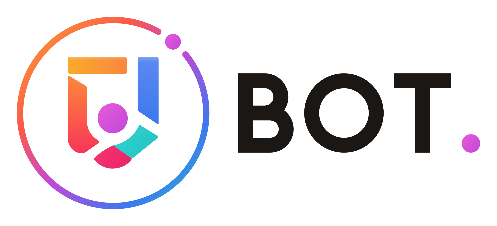

<div align="center">

**EN** | [CN](../CONTRIBUTING.md)

<picture>
  <source media="(prefers-color-scheme: dark)" srcset="../assets/logo/bot-logo-wordmark-en-light.png">
  
</picture>

</div>

# Contributing

Bug fixes, features, tests and documentation updates are all welcome. Most contributions go through a fork and pull request; maintainers may commit directly to `main` for changes whose scope has already been agreed.

> [!NOTE]
> This is a translation of the [Chinese contributing guide](../CONTRIBUTING.md), which remains the primary version. Pages marked (Chinese) are only available in Chinese for now.

## Scope of changes

Small fixes and documentation updates can go straight to a PR. For new dependencies, changes to data formats or database tables, cross-module architecture changes, or changes to existing commands or permissions, open an issue first that explains the goal, compatibility impact and migration path, and only then start implementing.

## Development environment

The minimum is Python 3.10; production runs Python 3.13, and CI tests Python 3.10–3.13 on Linux. `pyproject.toml` is the source of truth for dependency and tool versions.

```bash
python -m venv .venv
```

Activate it on Windows PowerShell:

```powershell
.\.venv\Scripts\Activate.ps1
```

Activate it on Linux / macOS:

```bash
source .venv/bin/activate
```

Install the runtime and development dependencies:

```bash
python -m pip install -r requirements.txt -r requirements-dev.txt
```

For the `.env` settings needed to run the bot and for the MySQL migration, see the [README](README.en.md). The regular test suite needs neither a Discord token nor a production MySQL server: tests run against temporary data with outbound network access restricted.

## Code and data access

- Use clear English names for functions, classes and variables. Comments, docstrings and user-facing text may be in Traditional Chinese.
- Log messages describe the event, state and cause; don't write them as instructions aimed at a particular operator.
- Cogs handle Discord arguments, permissions, confirmations and presentation. Business changes go through public service methods; never modify a service's settings dict or private cache directly. Query results are independent copies. A failed save must raise, and in-memory state is only published after a successful save.
- See the [development guide](DEVELOPMENT.md) (Chinese) for how new features are loaded and layered. `src/cogs` scans non-package modules automatically, so pure helpers belong in `src/utils` or `src/services`; there is no manual load list to maintain.
- Business documents go through `src/utils/document_store.py`. In MySQL mode, never read or write the old JSON files directly, and never fall back to the pre-migration snapshot when the database fails.
- Synchronous database and external-service calls must not block the Discord event loop for long. Wrap a full synchronous read-modify-save in `run_storage()`; for network calls, use an async client, or run them in the background with a sensible timeout.
- Interaction commands should respond or defer before any slow work, and handle expired interactions and API timeouts.
- Keep existing encryption keys and encrypted cookies. If the original key is missing, never generate a replacement that would overwrite existing accounts.

## Data migration and test isolation

Production storage uses Oracle MySQL 8.4 with PyMySQL. Business documents are stored as complete JSON in `documents`; operational history, caches, metrics and audit data live in separate tables.

Any storage change must be checked for compatibility with existing data. Before migrating, stop every writer to the sources, back up the original JSON / SQLite files and the encryption key, then verify source hashes, document contents and table rows. A failed migration must roll back its transaction and must never delete the original files or backups.

Regular tests:

```bash
python -m pytest -q
```

MySQL integration tests always run in a dedicated MySQL 8.4 job on CI. To run them locally, set up a separate MySQL account and test database; the database name must end in `_test`. The example below uses a test database created beforehand, with connection details supplied through environment variables for the test process:

```powershell
$env:MYSQL_INTEGRATION_TEST = "1"
$env:MYSQL_TEST_DATABASE = "new_bot_test"
python -m pytest tests/test_mysql_storage.py tests/test_storage_reliability.py tests/test_service_boundaries.py tests/test_achievement_storage.py tests/test_content_alignment.py tests/test_tool_mysql.py -q
```

The test account must not have any privileges on the production database, and integration tests must never point at it. It's expected for these tests to be skipped in a regular run.

## Formatting and checks

Sort imports first, then format:

```bash
python -m isort src services tests
python -m black src services tests
```

Before committing, run the same checks as CI:

```bash
python -m pytest -v --cov=src --cov-report=xml
python -m flake8 src services tests
python -m black --check src services tests
python -m isort --check-only src services tests
python -m bandit -r src services -ll
```

New tests should check observable behavior, error handling or data integrity; avoid hitting production services or mirroring implementation details. For text-only changes, reviewing the content, links and diff is enough; there's no need to restart the bot.

## Commits and pull requests

Commit messages and PR titles use Conventional Commits prefixes followed by a short description in Traditional Chinese:

- `feat:` new feature, e.g. `feat: 導入 MySQL 儲存與資料遷移`
- `fix:` bug fix, e.g. `fix: 修復資料庫未啟動時的機器人初始化`
- `docs:` documentation
- `style:` formatting
- `refactor:` refactoring
- `test:` tests

A PR description should cover the problem, the new behavior and how you verified it. If it involves a data migration, also describe backups, compatibility and how to roll back, and link any related issue. The bot and the website live in separate repositories, so submit cross-project changes to each one separately.

Only commit files related to your change. Never commit `.env`, tokens, passwords, encryption keys, cookies, user data, database files or local backups; documentation and examples should use empty or placeholder values only.

## License

The current version is licensed under **AGPL-3.0-only**, authored by **Keeiv**. See [LICENSE](../LICENSE) for the full text and [NOTICE](../NOTICE) for copyright notices. New contributions are accepted under the same license, and contributor and third-party copyright notices are preserved.

If a modified version is offered as an interactive network service, it must tell users, somewhere they can see it, how to get the complete corresponding source for the running version. That source should include whatever is needed to build and install it, but no tokens, passwords, cookies or user data.

Releases already published under MIT can still be used on those terms; the old notice is kept in [LICENSES/MIT-legacy.txt](../LICENSES/MIT-legacy.txt).
